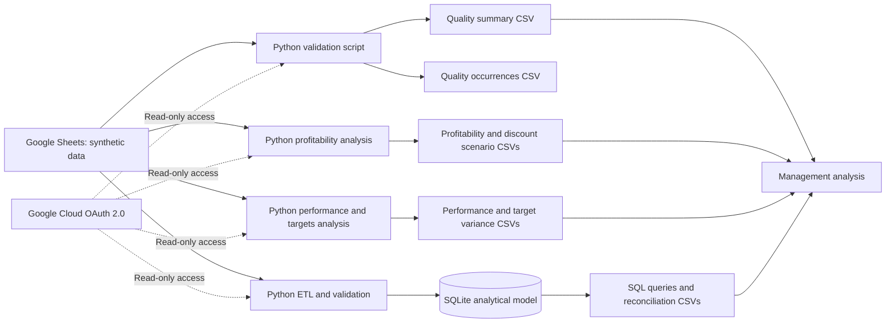

# WS-02 | Retail Intelligence

A retail analytics portfolio project by WS Estratégia e Inteligência Artificial.

**Status:** v0.4.0 milestone published; v0.5.0 Executive Dashboard candidate — Power BI implemented locally, exporter and documentation published; PBIP source publication and runtime acceptance pending. Independent portfolio project; not a production deployment.

## Business problem

Commercial managers need reliable sales, customer traffic and target data before evaluating performance, profitability and sales strategies. Inconsistent records can distort management indicators and lead to poor pricing and operational decisions.

## Phase 1 — Data quality validation

The validation script uses a read-only Google Sheets integration to audit a simulated consumer electronics retail dataset covering six commercial units and twelve SKUs, with sales, traffic and commercial targets.

Validation covers required fields, duplicate keys, numerical and date validity, price/cost and discount consistency, period coverage, SKU consistency, cross-table integrity and negative gross profit.

### Architecture



### Results

The script ran successfully on a local Windows environment using OAuth authentication. The audit classified the dataset as **fit for analysis with caveats (APTO COM RESSALVAS)** and flagged 12 sales records with negative gross profit.

A subsequent review of the flagged source rows identified the following results:

| Metric | Result |
| --- | ---: |
| Flagged sales records | 12 |
| Units sold within flagged records | 54 |
| Affected SKUs | 4 |
| Affected commercial units | 1 |
| Gross sales before discounts | BRL 477,946.00 |
| Discounts | BRL 86,372.29 |
| Net sales after discounts | BRL 391,573.71 |
| Cost of goods sold | BRL 395,562.50 |
| Gross profit | BRL -3,988.79 |
| Gross margin | -1.02% |

All flagged records belong to the simulated Porto Alegre physical store in October 2026. Results concern only the flagged subset, not the overall store or dataset. Discounts exceeded the break-even threshold in these records; the business reason remains unverified. Negative gross profit is a commercial alert and not, by itself, a data error.

## Phase 2 — Commercial profitability analysis

The second Python module aggregates daily sales records by commercial unit, SKU and month; computes weighted margins and discounts; identifies break-even discount thresholds for each observed price/cost combination; and simulates minimum gross margin policies.

### Verified results (September–October 2026)

| Indicator | Result |
| --- | ---: |
| Daily unit/SKU observations | 4,392 |
| Observations with sales | 3,369 |
| Zero-sales observations | 1,023 |
| Units sold | 12,253 |
| Gross sales before discounts | BRL 46,839,327.00 |
| Discounts | BRL 2,520,176.04 |
| Net sales after discounts | BRL 44,319,150.96 |
| Cost of goods sold | BRL 37,151,670.50 |
| Gross profit | BRL 7,167,480.46 |
| Gross margin | 16.17% |
| Weighted discount | 5.38% |

Net sales grew 11.89% from September to October, but gross profit declined 2.48%, with gross margin falling from 17.35% to 15.12%. The simulated Porto Alegre store showed net sales growth of 26.08%, gross profit decline of 27.91% and margin compression from 17.31% to 9.90%.

The October Porto Alegre discount scenarios produced the following static results:

| Scenario | Gross profit | Gross margin | Uplift vs. baseline |
| --- | ---: | ---: | ---: |
| Baseline | BRL 467,733.79 | 9.90% | — |
| Minimum row-level margin of 0% | BRL 471,722.58 | 9.97% | BRL 3,988.79 |
| Minimum row-level margin of 5% | BRL 532,754.82 | 11.12% | BRL 65,021.03 |

These are simulated improvements under unchanged volumes and costs, not forecasts or realised savings. Demand elasticity, operating expenses, taxes and changes in product mix are not modelled. The 5% threshold is an experimental assumption, not an approved pricing policy.

The seven local report files were cross-checked for consistent totals across unit, product and period dimensions. The source-level negative gross profit total also matches the consolidated loss amount. Zero-quantity rows with zero discounts are valid observations; the corrected script explicitly preserves them.

See [commercial profitability case study](docs/commercial_profitability_analysis.md) for methodology, findings and proposed management actions.

## Phase 3 — Commercial performance & targets

The third Python module integrates daily SKU-level sales with unit/day traffic and monthly targets, using pre-aggregation and checked one-to-one joins to prevent double-counting. It calculates conversion, average ticket, items per order, revenue per visit, target attainment and revenue variance components while keeping physical visits and digital sessions separate.

| Indicator | September | October |
| --- | ---: | ---: |
| Network sales target attainment | 105.26% | 106.48% |
| Gross margin | 17.35% | 15.12% |
| Individual targets met | 16/18 | 11/18 |

São Paulo was the only unit to meet all three October targets. Curitiba's conversion fell from 14.61% to 9.77% despite higher daily traffic; Porto Alegre's revenue grew but margins declined. The analysis recommends investigating conversion in Curitiba and discount governance in Porto Alegre. These are hypotheses and proposed actions, not validated operational causes.

The six performance reports were generated successfully, and their financial, traffic and target totals reconciled with the submitted reports. See the [performance and targets case study](docs/commercial_performance_targets.md) for the detailed methodology, scorecard, revenue bridge, validation evidence and limitations.

## Phase 4 — SQL data modelling

The local SQLite fact constellation separates sales (day/unit/SKU), traffic (day/unit), and targets (month/unit), with four shared dimensions. Monetary values are stored in integer cents. The loader validates source data, builds a temporary snapshot, checks database integrity and reconciles SQL metrics against Pandas before replacing the previous database.

Seven analytical queries and a reconciliation report were generated. All 24 recorded controls passed; independent cross-checks against Phase 2 and 3 exports confirmed matching common metrics, including BRL 44,319,150.96 in net sales and BRL 7,167,480.46 in gross profit. The twelve negative-profit records also reconciled to a loss of BRL 3,988.79.

See [SQL data modelling case study](docs/sql_data_modelling.md) and [setup instructions](SQL_SETUP.md). The local database itself was not supplied for separate inspection; the results are supported by the report archive and execution evidence.

## Phase 5 — Executive Dashboard

The locally implemented Power BI project contains five report pages, 46 visual definitions and 31 DAX measures, based on the SQL dimensional model. The corrected Visits measure prevents aggregation of physical visits and online sessions across channels. Static source review is complete; runtime acceptance in Power BI Desktop remains pending.

Run `python export_powerbi_data.py` to export the validated SQLite model as seven CSVs in `data/powerbi/`. See the [dashboard case study and setup](docs/executive_dashboard.md) for data types, report scope, DAX measures, reference KPIs and validation criteria. PBIP source publication is pending.

## Repository structure

```text
.
├── README.md
├── requirements.txt
├── validate_commercial_data.py
├── analyze_commercial_profitability.py
├── analyze_commercial_performance.py
├── build_retail_database.py
├── test_sql_model.py
├── export_powerbi_data.py
├── SQL_SETUP.md
├── sql/
│   ├── schema.sql
│   └── queries.sql
├── docs/
│   ├── commercial_profitability_analysis.md
│   ├── commercial_performance_targets.md
│   ├── sql_data_modelling.md
│   └── executive_dashboard.md
├── CHANGELOG.md
└── .gitignore
```

Local credentials, OAuth tokens, virtual environments and generated reports are excluded from version control.

## Running locally

Prerequisites: Python, access to a compatible Google Sheets dataset, an enabled Google Sheets API and a desktop OAuth client. For an external OAuth app in testing mode, the authenticating account must be an approved test user and have read access to the spreadsheet.

Windows PowerShell:

```powershell
python -m venv .venv
.\.venv\Scripts\Activate.ps1
python -m pip install -r requirements.txt
```

Download your own OAuth client credentials and save them locally as `credentials.json`. Set `SHEET_ID` in `validate_commercial_data.py` to a compatible spreadsheet you can access. The original working spreadsheet is not distributed here; reproduction requires a compatible dataset.

```powershell
python validate_commercial_data.py
```

Complete the browser consent flow if prompted. The locally executed script requested read-only spreadsheet access.

Local outputs:

- `reports/quality_report.csv` — validation rules, occurrence counts and results.
- `reports/quality_occurrences.csv` — source sheet, row number, rule and severity.

Run the profitability module after validating the dataset:

```powershell
python analyze_commercial_profitability.py --spreadsheet "<YOUR_SHEET_ID_OR_URL>"
```

Alternatively, omit the argument to enter the spreadsheet URL interactively. The module reads the `Vendas` tab (columns A–L) and can reuse a compatible local OAuth token. The September/October comparison is specific to the demonstration period. Seven CSVs are written to `reports/profitability/`:

- `profitability_by_unit.csv`
- `profitability_by_product.csv`
- `profitability_by_unit_month.csv`
- `monthly_comparison_sep_oct.csv`
- `discount_limits_by_sku.csv`
- `discount_scenarios.csv`
- `negative_profit_details.csv`

Run the performance module with the corrected profitability module in the same directory:

```powershell
python analyze_commercial_performance.py --spreadsheet "<YOUR_SHEET_ID_OR_URL>"
```

It reads `Vendas` (A:L), `Fluxo` (A:G) and `Metas` (A:G) with read-only access, reconciles source totals and writes six CSVs to `reports/performance/`:

- `daily_performance.csv`
- `monthly_performance_targets.csv`
- `channel_performance.csv`
- `monthly_performance_comparison.csv`
- `network_financial_performance.csv`
- `target_exceptions.csv`

Test and build the SQL model:

```powershell
python test_sql_model.py
python build_retail_database.py --spreadsheet "<YOUR_SHEET_ID_OR_URL>"
```

The loader creates `data/retail_intelligence.sqlite3` and eight CSVs in `reports/sql/`. It uses full snapshot replacement; see [SQL_SETUP.md](SQL_SETUP.md) for operational details. Python 3.12+ also provides the SQLite shell via `python -m sqlite3 data/retail_intelligence.sqlite3`.

CSV format: UTF-8 with BOM, semicolon delimiter and decimal comma.

Never commit credentials or OAuth tokens. The generated SQLite database, CSVs and local ZIP archives remain outside version control.

## Roadmap

- [x] Data quality validation and Google Sheets OAuth integration
- [x] Commercial profitability and discount scenario analysis
- [x] Commercial performance, targets and conversion analysis
- [x] SQL data modelling and analytical queries
- [ ] Executive BI dashboard (implemented locally; source publication and runtime acceptance pending)
- [ ] AI-assisted commercial analysis
- [ ] Workflow automation
- [ ] Reproducible demonstration dataset and broader automated tests

## Disclaimer

All commercial data and results in this project are synthetic. They do not represent actual iPlace or Apple sales, costs, pricing policies or financial performance. This project is not affiliated with either company.
