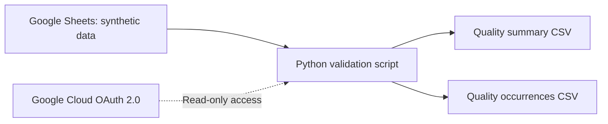

# WS-02 | Retail Intelligence

A retail analytics portfolio project by WS Estratégia e Inteligência Artificial.

**Status:** Automated data quality validation implemented and executed successfully against a synthetic commercial dataset. The repository includes the original validated source code and dependency manifest.

## Business problem

Commercial managers need reliable sales, customer traffic and target data before evaluating performance, profitability and sales strategies. Inconsistent records can distort management indicators and lead to poor pricing and operational decisions.

## Data quality validation

The validation script uses a read-only Google Sheets integration to audit a simulated consumer electronics retail dataset covering six commercial units and twelve SKUs, with sales, traffic and commercial targets.

Validation covers required fields, duplicate keys, numerical and date validity, price/cost and discount consistency, period coverage, SKU consistency, cross-table integrity and negative gross profit.

### Architecture



### Results

The script ran successfully on a local Windows environment using OAuth authentication. The audit classified the dataset as **fit for analysis with caveats (APTO COM RESSALVAS)** and flagged 12 sales records with negative gross profit.

A subsequent review of the flagged source rows identified the following results:

| Metric | Result |
| --- | ---: |
| Flagged sales records | 12 |
| Units sold within flagged records | 54 |
| Affected SKUs | 4 |
| Affected commercial units | 1 |
| Gross sales before discounts | BRL 477,946.00 |
| Discounts | BRL 86,372.29 |
| Net sales after discounts | BRL 391,573.71 |
| Cost of goods sold | BRL 395,562.50 |
| Gross profit | BRL -3,988.79 |
| Gross margin | -1.02% |

All flagged records belong to the simulated Porto Alegre physical store in October 2026. Results concern only the flagged subset, not the overall store or dataset. Discounts exceeded the break-even threshold in these records; the business reason remains unverified. Negative gross profit is a commercial alert and not, by itself, a data error.

## Repository structure

```text
.
├── README.md
├── requirements.txt
├── validate_commercial_data.py
└── .gitignore
```

Local credentials, OAuth tokens, virtual environments and generated reports are excluded from version control.

## Running locally

Prerequisites: Python, access to a compatible Google Sheets dataset, an enabled Google Sheets API and a desktop OAuth client. For an external OAuth app in testing mode, the authenticating account must be an approved test user and have read access to the spreadsheet.

Windows PowerShell:

```powershell
python -m venv .venv
.\.venv\Scripts\Activate.ps1
python -m pip install -r requirements.txt
```

Download your own OAuth client credentials and save them locally as `credentials.json`. Set `SHEET_ID` in `validate_commercial_data.py` to a compatible spreadsheet you can access. The original working spreadsheet is not distributed here; reproduction requires a compatible dataset.

```powershell
python validate_commercial_data.py
```

Complete the browser consent flow if prompted. The locally executed script requested read-only spreadsheet access.

Local outputs:

- `reports/quality_report.csv` — validation rules, occurrence counts and results.
- `reports/quality_occurrences.csv` — source sheet, row number, rule and severity.

Never commit credentials or OAuth tokens.

## Disclaimer

All commercial data and results in this project are synthetic. They do not represent actual iPlace or Apple sales, costs, pricing policies or financial performance. This project is not affiliated with either company.
