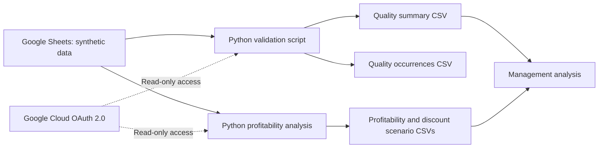

# WS-02 | Retail Intelligence

A retail analytics portfolio project by WS Estratégia e Inteligência Artificial.

**Status:** v0.2.0 milestone — automated data quality validation and commercial profitability analysis implemented and executed successfully on a local Windows environment against a synthetic commercial dataset. Independent portfolio project; not a production deployment.

## Business problem

Commercial managers need reliable sales, customer traffic and target data before evaluating performance, profitability and sales strategies. Inconsistent records can distort management indicators and lead to poor pricing and operational decisions.

## Phase 1 — Data quality validation

The validation script uses a read-only Google Sheets integration to audit a simulated consumer electronics retail dataset covering six commercial units and twelve SKUs, with sales, traffic and commercial targets.

Validation covers required fields, duplicate keys, numerical and date validity, price/cost and discount consistency, period coverage, SKU consistency, cross-table integrity and negative gross profit.

### Architecture



### Results

The script ran successfully on a local Windows environment using OAuth authentication. The audit classified the dataset as **fit for analysis with caveats (APTO COM RESSALVAS)** and flagged 12 sales records with negative gross profit.

A subsequent review of the flagged source rows identified the following results:

| Metric | Result |
| --- | ---: |
| Flagged sales records | 12 |
| Units sold within flagged records | 54 |
| Affected SKUs | 4 |
| Affected commercial units | 1 |
| Gross sales before discounts | BRL 477,946.00 |
| Discounts | BRL 86,372.29 |
| Net sales after discounts | BRL 391,573.71 |
| Cost of goods sold | BRL 395,562.50 |
| Gross profit | BRL -3,988.79 |
| Gross margin | -1.02% |

All flagged records belong to the simulated Porto Alegre physical store in October 2026. Results concern only the flagged subset, not the overall store or dataset. Discounts exceeded the break-even threshold in these records; the business reason remains unverified. Negative gross profit is a commercial alert and not, by itself, a data error.

## Phase 2 — Commercial profitability analysis

The second Python module aggregates daily sales records by commercial unit, SKU and month; computes weighted margins and discounts; identifies break-even discount thresholds for each observed price/cost combination; and simulates minimum gross margin policies.

### Verified results (September–October 2026)

| Indicator | Result |
| --- | ---: |
| Daily unit/SKU observations | 4,392 |
| Observations with sales | 3,369 |
| Zero-sales observations | 1,023 |
| Units sold | 12,253 |
| Gross sales before discounts | BRL 46,839,327.00 |
| Discounts | BRL 2,520,176.04 |
| Net sales after discounts | BRL 44,319,150.96 |
| Cost of goods sold | BRL 37,151,670.50 |
| Gross profit | BRL 7,167,480.46 |
| Gross margin | 16.17% |
| Weighted discount | 5.38% |

Net sales grew 11.89% from September to October, but gross profit declined 2.48%, with gross margin falling from 17.35% to 15.12%. The simulated Porto Alegre store showed net sales growth of 26.08%, gross profit decline of 27.91% and margin compression from 17.31% to 9.90%.

The October Porto Alegre discount scenarios produced the following static results:

| Scenario | Gross profit | Gross margin | Uplift vs. baseline |
| --- | ---: | ---: | ---: |
| Baseline | BRL 467,733.79 | 9.90% | — |
| Minimum row-level margin of 0% | BRL 471,722.58 | 9.97% | BRL 3,988.79 |
| Minimum row-level margin of 5% | BRL 532,754.82 | 11.12% | BRL 65,021.03 |

These are simulated improvements under unchanged volumes and costs, not forecasts or realised savings. Demand elasticity, operating expenses, taxes and changes in product mix are not modelled. The 5% threshold is an experimental assumption, not an approved pricing policy.

The seven local report files were cross-checked for consistent totals across unit, product and period dimensions. The source-level negative gross profit total also matches the consolidated loss amount. Zero-quantity rows with zero discounts are valid observations; the corrected script explicitly preserves them.

See [commercial profitability case study](docs/commercial_profitability_analysis.md) for methodology, findings and proposed management actions.

## Repository structure

```text
.
├── README.md
├── requirements.txt
├── validate_commercial_data.py
├── analyze_commercial_profitability.py
├── docs/
│   └── commercial_profitability_analysis.md
├── CHANGELOG.md
└── .gitignore
```

Local credentials, OAuth tokens, virtual environments and generated reports are excluded from version control.

## Running locally

Prerequisites: Python, access to a compatible Google Sheets dataset, an enabled Google Sheets API and a desktop OAuth client. For an external OAuth app in testing mode, the authenticating account must be an approved test user and have read access to the spreadsheet.

Windows PowerShell:

```powershell
python -m venv .venv
.\.venv\Scripts\Activate.ps1
python -m pip install -r requirements.txt
```

Download your own OAuth client credentials and save them locally as `credentials.json`. Set `SHEET_ID` in `validate_commercial_data.py` to a compatible spreadsheet you can access. The original working spreadsheet is not distributed here; reproduction requires a compatible dataset.

```powershell
python validate_commercial_data.py
```

Complete the browser consent flow if prompted. The locally executed script requested read-only spreadsheet access.

Local outputs:

- `reports/quality_report.csv` — validation rules, occurrence counts and results.
- `reports/quality_occurrences.csv` — source sheet, row number, rule and severity.

Run the profitability module after validating the dataset:

```powershell
python analyze_commercial_profitability.py --spreadsheet "<YOUR_SHEET_ID_OR_URL>"
```

Alternatively, omit the argument to enter the spreadsheet URL interactively. The module reads the `Vendas` tab (columns A–L) and can reuse a compatible local OAuth token. The September/October comparison is specific to the demonstration period. Seven CSVs are written to `reports/profitability/`:

- `profitability_by_unit.csv`
- `profitability_by_product.csv`
- `profitability_by_unit_month.csv`
- `monthly_comparison_sep_oct.csv`
- `discount_limits_by_sku.csv`
- `discount_scenarios.csv`
- `negative_profit_details.csv`

CSV format: UTF-8 with BOM, semicolon delimiter and decimal comma.

Never commit credentials or OAuth tokens. Generated CSVs and local ZIP archives remain outside version control.

## Roadmap

- [x] Data quality validation and Google Sheets OAuth integration
- [x] Commercial profitability and discount scenario analysis
- [ ] Commercial performance, targets and conversion analysis
- [ ] SQL data modelling and analytical queries
- [ ] Executive BI dashboard
- [ ] AI-assisted commercial analysis
- [ ] Workflow automation
- [ ] Reproducible demonstration dataset and broader automated tests

## Disclaimer

All commercial data and results in this project are synthetic. They do not represent actual iPlace or Apple sales, costs, pricing policies or financial performance. This project is not affiliated with either company.
